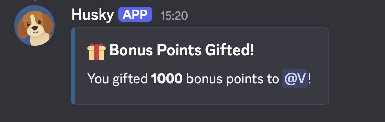
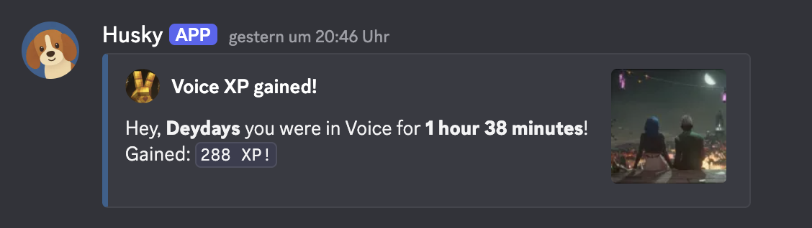
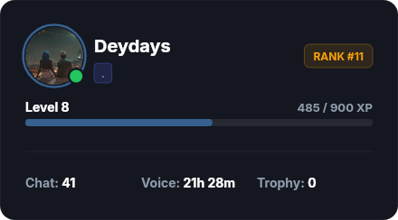
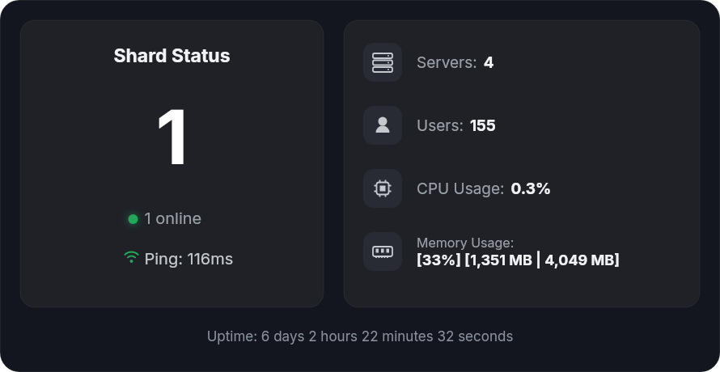

# Husky Bot

A free, modern, powerful, and feature-rich Discord activity tracking and leveling bot.

  Husky monitors server activity, calculates voice and text experience points (XP), automatically assigns level-based roles, displays real-time server stats, and maintains auto-updating persistent channel leaderboards.

---

## How to use

> [!TIP]
> Ready to track activity on your server? **[Click here to invite Husky Bot](https://bilendev.net/invite)** directly with the required permissions.

---

## Features

> **100% Free & Open-Source:** Every single feature is available completely free of charge — no subscriptions, no paywalls, and no hidden fees.

- **Text & Voice XP Tracking:** Real-time XP rewards for active chatters and voice channel members.
- **Dynamic Leaderboards:** Real-time `/top` command with active member filtering and persistent auto-updating channel leaderboards via webhooks.
- **Automated Role Rewards:** Level-based role assignment and sticky roles on member rejoins.
- **Rich Graphical Stats:** Visual `/stats` and `/rank` cards generated directly on Canvas.
- **Fully Customizable:** Server administrators can configure XP multipliers, cooldowns, bonus roles, and channels.
- **High Performance Architecture:** Built on Discord.js v14, TypeScript, MySQL, and Docker.

---

## Changelog

Key updates, improvements, and changes made to HuskyBot:

### Features
- **Bonus XP Gifting (`/gift`):** Server members can now gift bonus XP directly to one another.
   
  

- **Voice XP Notifications:** Sends a direct message detailing total XP earned and time spent upon leaving a voice channel.
   
  

- **Visual `/rank` & `/status` Cards:** Completely refreshed graphical Canvas cards for member ranks and server statistics.
   
  
  

- **Optimized `/bonus role` System:** Streamlined bulk bonus distribution using batched DB reads and in-memory cache flushing for large servers.
- **Clan / Guild Tag System (`/config-guildtag`):** Background tag scanning with member prechecks and hierarchy protection.

### Design & Style
- **Embed Color Refresh:** Updated primary embed accent color to `#36608e`.
- **Canvas Visual Improvements:** Polished UI and layout on `/rank` and `/status` image generation.

### Fixes
- **Leaderboard Cleanup:** Automatically excludes members who have left the guild from leaderboards.
- **Manager Shard Error Handling:** Added `shard.on('error')` handling with exponential backoff retries (`MAX_START_RETRIES = 5`) to prevent manager process crashes.
- **Gateway Login Retries:** Wrapped `client.login()` with automatic retries to recover from momentary Discord gateway drops (502, 503, ETIMEDOUT).
- **Dead Shard False-Positive Fix:** Added WebSocket status verification to prevent terminating idle shards during quiet hours.
- **Guild Tag Role Revocation:** Fixed role cleanup when tags are changed or removed, with safe handling of Gateway Opcode 8.
- **Bonus Task Safety:** Added timeout cleanup (`clearTimeout`), safe job locks via `try/finally`, and member validation guards.

---

## Credits

Husky is an open-source project based on and forked from [ActivityRank](https://github.com/Rapha01/activityRank-bot), originally developed by:
- [@rapha01](https://github.com/rapha01)
- [@piemot](https://github.com/piemot)
- And the [ActivityRank Contributors](https://github.com/Rapha01/activityRank-bot/graphs/contributors)

---

## License

This project is licensed under the AGPL v3.0 License - see the [LICENSE](LICENSE) file for details.
